# Karten — German flashcards (A2–B1)

**Karten** is a calm, offline flashcard app for learning everyday German at A2–B1 level, with a Russian
interface and a soft spot for Austrian German. No account, no backend, no ads — your progress stays on
the device.

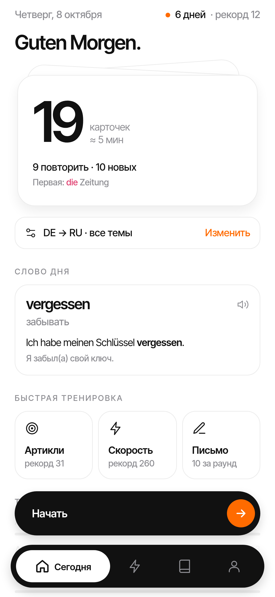

## Features

- **390 hand-picked words in 11 topics** — everyday life, work, flat, offices (Amt), shopping, health,
  transport, food, time, plus core verbs and adjectives. 42 entries carry the Austrian variant
  (Paradeiser, Erdäpfel, Jänner…).
- **Spaced repetition** — an SM-2-style scheduler builds a daily queue of due + new cards; streaks and stats.
- **Rich cards** — article colour dot, plural, verb principal parts, example sentence with translation,
  text-to-speech pronunciation.
- **Mini games** — *der / die / das* article game, a speed round and a typing drill with an umlaut/case
  tolerant checker and a character-level diff.
- **Your own words** — add custom cards, browse and search the whole dictionary.
- **15 achievements**, daily reminders (local notifications) and a *Word of the day* home-screen widget.
- **Minimal design** — Inter Tight, light and true-black dark theme, one orange accent, a bundled icon font.
- Safe data model with versioned migration and backups.

## Screenshots

| Home | Card | Article game | Typing | Dark mode |
|---|---|---|---|---|
| 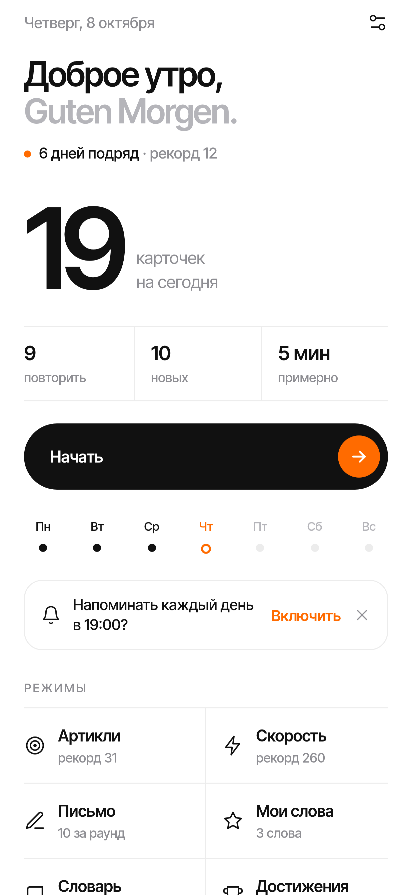 | 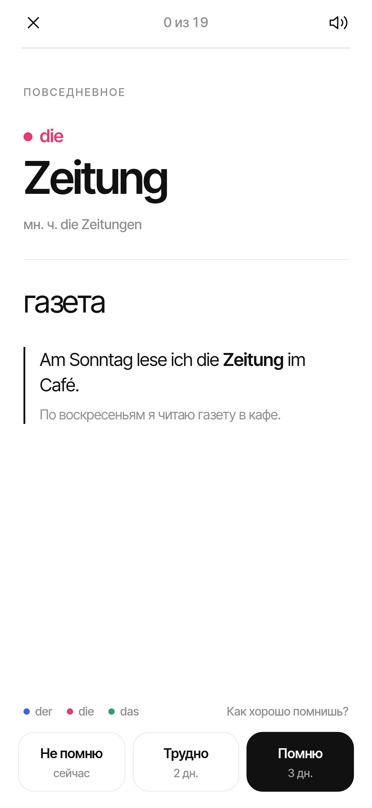 | 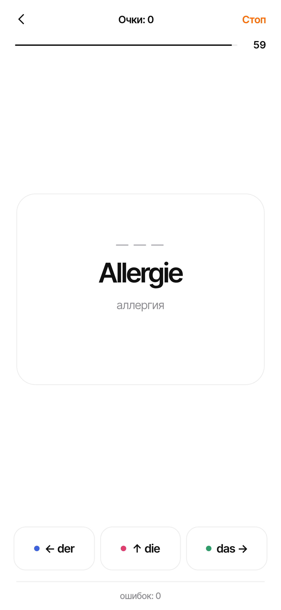 | 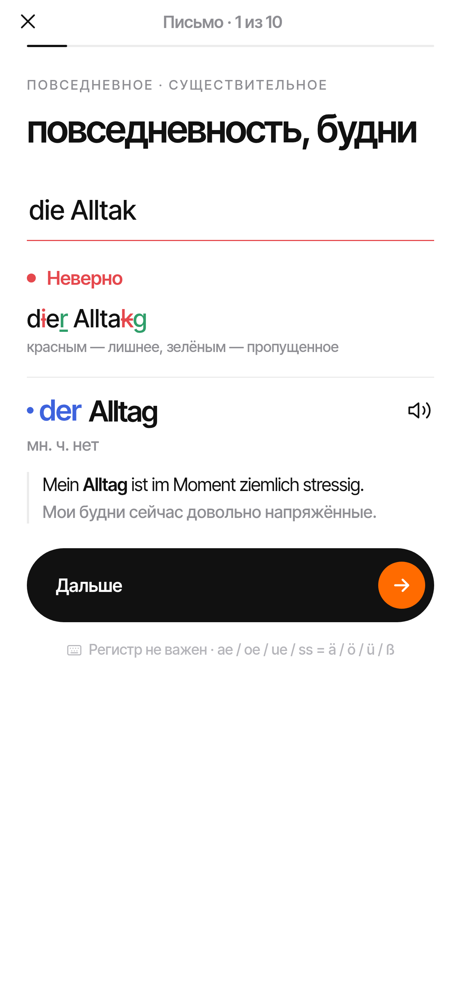 | 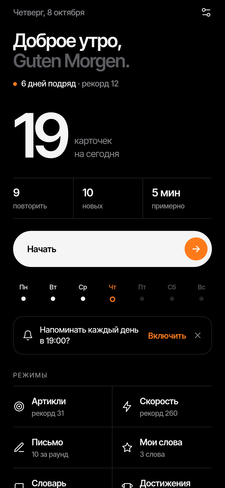 |

| Speed round | Custom words | Dictionary | Achievements | Settings |
|---|---|---|---|---|
| 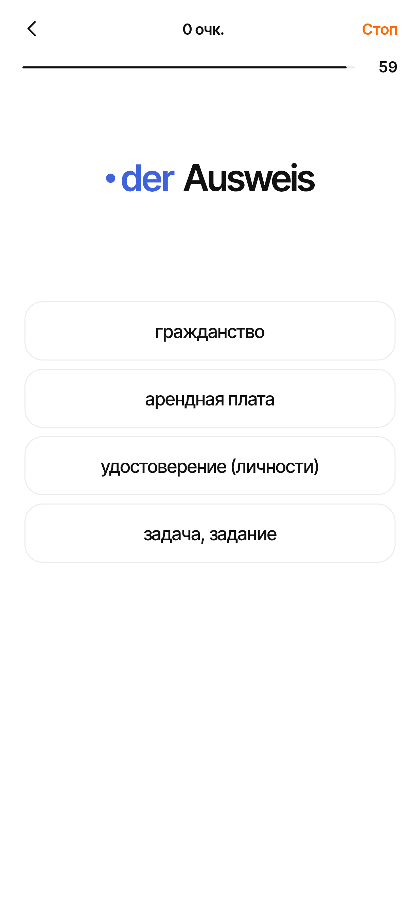 | 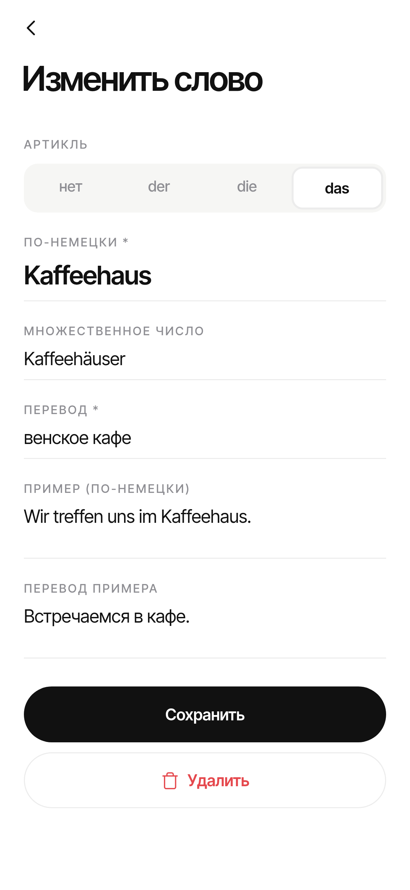 | 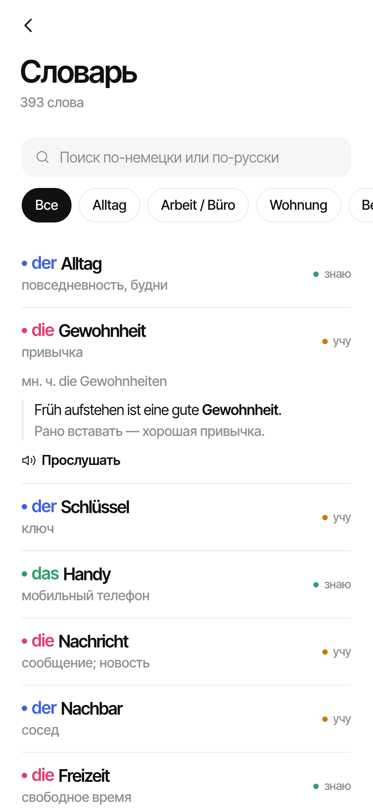 | 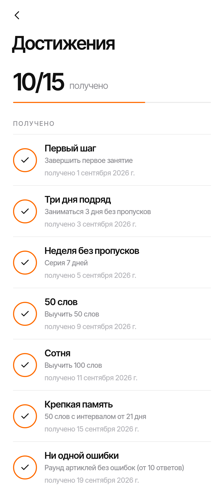 | 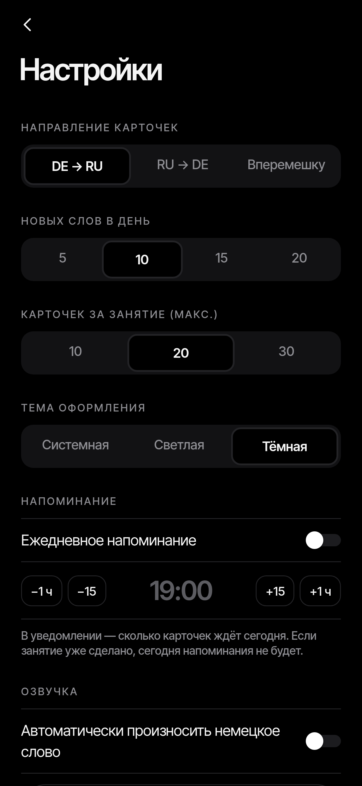 |

All screenshots are rendered from the real app code (react-native-web + headless Chrome), see
`scripts/web-screens/`. Earlier design explorations live in `design/`.

## Tech stack

- **Expo SDK 57**, **React Native 0.86** (New Architecture, Hermes), **TypeScript**
- `@react-native-async-storage/async-storage` for persistence, `expo-notifications` for reminders,
  `expo-speech` for pronunciation, `react-native-android-widget` for the home-screen widget
- Tests: `node:test` via `tsx` (logic) and Jest + React Native Testing Library (UI)
- Local Gradle release build (no EAS): arm64-v8a only, R8 + resource shrinking, uncompressed 16 KB-aligned
  native libraries, APK signature schemes v1 + v2 + v3

## Project layout

| Path | What |
|---|---|
| `src/data/` | the deck (`words.ts`, topic → entries, `at` = Austrian word) and RU translations of examples |
| `src/logic/` | pure logic: data model + migration, store, SRS scheduler, typing checker, games, achievements, reminder plan |
| `src/screens/` | Home (Сегодня), Train, Browse, Profile (tabs) + Session, Settings, Article, Speed, Typing, CustomWords, Achievements |
| `src/ui/` | theme tokens, components, icon font glyphs, notifications, speech |
| `src/widget/` | *Word of the day* Android widget |
| `scripts/` | build configuration, toolchain installer, font / icon / brand asset generators, web screenshots |
| `tests/`, `tests-rn/` | logic tests and UI tests |

## Build

Requirements: Node 22, JDK 17, Android SDK + NDK (see `scripts/install-toolchain.sh`; `env.sh` puts them on the PATH).

```bash
. ./env.sh
npm install
npm run typecheck          # tsc --noEmit
npm test                   # logic tests (node:test)
npm run test:ui            # UI tests (jest + RNTL)

# release APK
CI=1 npx expo prebuild --platform android --clean --no-install
./scripts/configure-android.sh     # signing v1+v2+v3, arm64-only, stored 16 KB-aligned libs, R8
cd android && ./gradlew assembleRelease
# -> android/app/build/outputs/apk/release/app-release.apk
```

### Signing

Release signing reads `keystore/keystore.properties`, which is **not** in git. Copy
`keystore/keystore.properties.example`, put your keystore next to it and fill in your own passwords — see
`keystore/README.md`. Keystores, passwords, APKs and build logs are git-ignored.

## License

MIT, see [LICENSE](LICENSE). Fonts: Inter Tight (SIL Open Font License 1.1, `assets/fonts/LICENSE.txt`).
