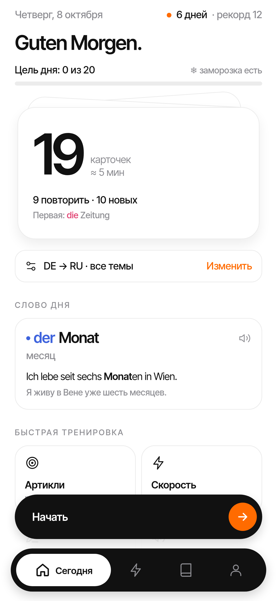
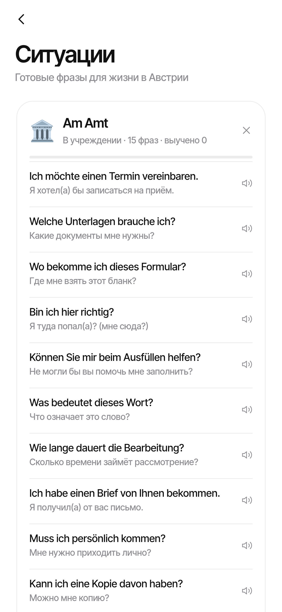
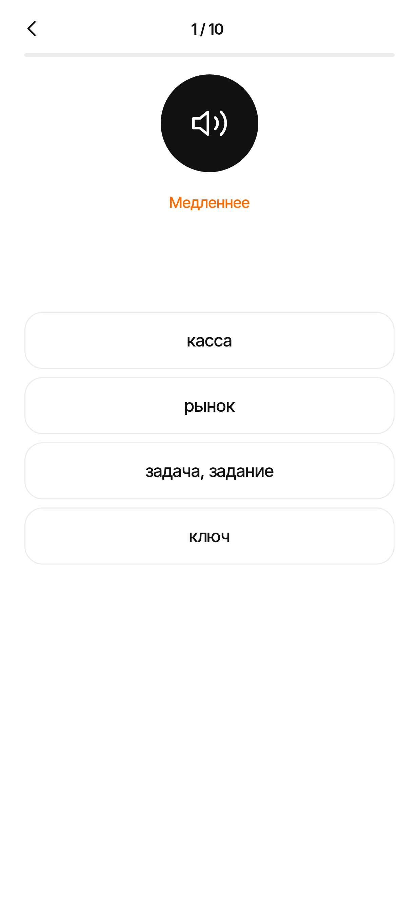
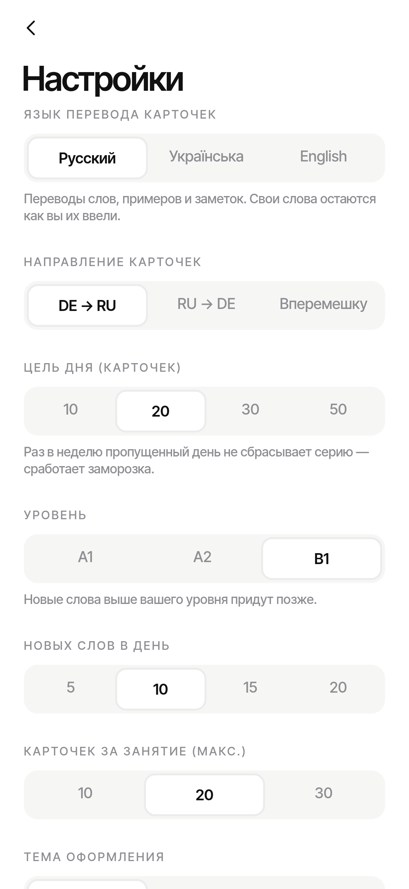
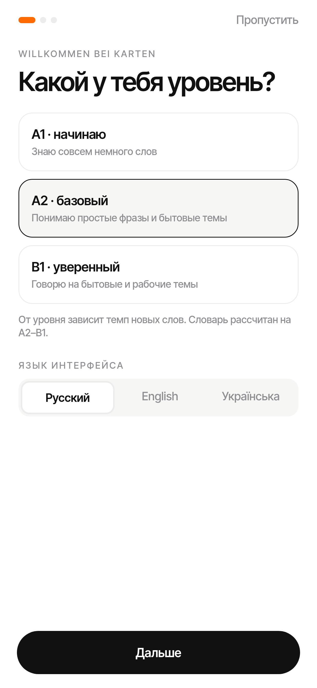
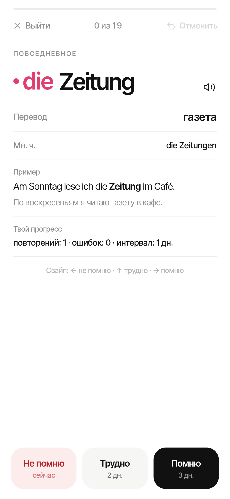
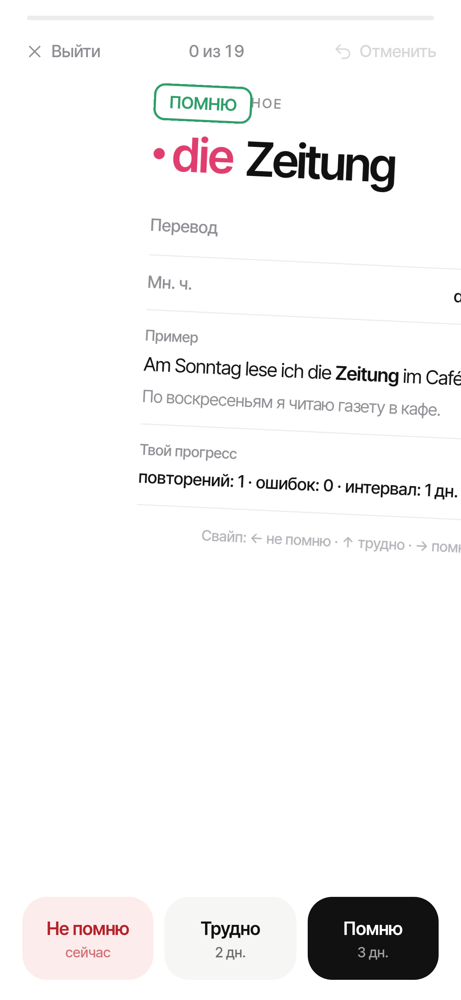
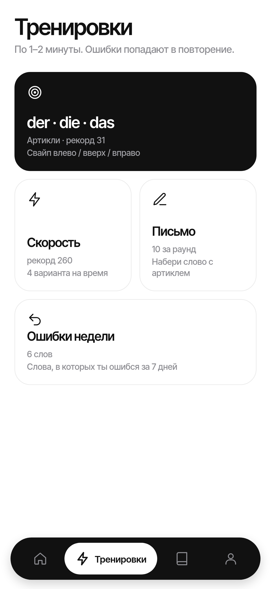
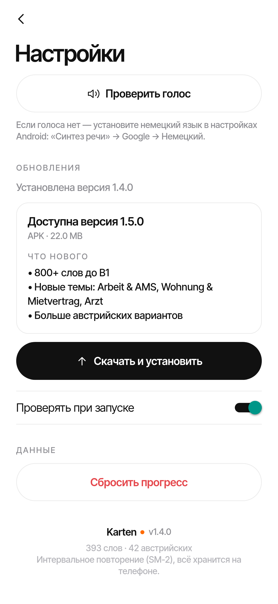

# Karten — German flashcards (A1–B1)

**Karten** is a calm, offline flashcard app for learning everyday German at A1–B1 level, with a Russian, Ukrainian or English
interface and a soft spot for Austrian German. No account, no backend, no ads — your progress stays on
the device.



## Features

- **999 entries in 16 topics, levelled A1 / A2 / B1** (301 / 425 / 273) — everyday life, work & AMS, flat &
  landlord, offices (Amt), doctor, bank & money, study & courses, leisure, feelings, shopping, transport, food,
  time, core verbs and adjectives, plus 123 ready-made phrases. 116 entries carry the Austrian variant
  (Paradeiser, Erdäpfel, Jänner…). New words above your level are scheduled later.
- **Translations in Russian, Ukrainian or English** — meanings, examples and notes; pick the card language in
  Settings independently of the interface language. Your own words stay as you typed them.
- **Situation packs** — *Am Amt*, *Beim Arzt*, *Mit dem Vermieter*: phrases to read, listen to and learn as a set.
- **Listening mode** — hear a word or phrase (normal or slow), pick the translation; mistakes go to review.
- **Daily goal** (10/20/30/50 cards) with confetti, and a weekly **streak freeze** that saves one missed day.
- **Spaced repetition** — an SM-2-style scheduler builds a daily queue of due + new cards; streaks and stats.
- **Rich cards** — article colour dot, plural, verb principal parts, example sentence with translation,
  text-to-speech pronunciation.
- **Mini games** — *der / die / das* article game, a speed round and a typing drill with an umlaut/case
  tolerant checker and a character-level diff.
- **Your own words** — add custom cards, browse and search the whole dictionary.
- **Swipe grading** (← forgot · ↑ hard · → got it), undo, and a *Mistakes of the week* practice.
- **First-launch onboarding** (level, topics, new words per day) and **RU / EN / UK interface**.
- **In-app updates** — Settings checks the latest GitHub release, shows the changelog, downloads the APK and opens the Android installer.
- **15 achievements**, daily reminders (local notifications) and a *Word of the day* home-screen widget.
- **Minimal design** — a springy Reanimated tab bar (stretching capsule + label crossfade), Inter Tight, light and true-black dark theme, one orange accent, a bundled icon font.
- Safe data model with versioned migration and backups.

## Screenshots

| Today · daily goal | Situation packs | Listening | Card in English | Card in Ukrainian | Settings |
|---|---|---|---|---|---|
|  |  |  |  |  |  |

1.4 screens:

| Onboarding | Card back | Swipe | Mistakes of the week | Update | English |
|---|---|---|---|---|---|
|  |  |  |  |  |  |

Older (1.2) screens:

| Home | Card | Article game | Typing | Dark mode |
|---|---|---|---|---|
|  |  |  |  |  |

| Speed round | Custom words | Dictionary | Achievements | Settings |
|---|---|---|---|---|
|  |  |  |  |  |

All screenshots are rendered from the real app code (react-native-web + headless Chrome), see
`scripts/web-screens/`. Earlier design explorations live in `design/`.

## Tech stack

- **Expo SDK 57**, **React Native 0.86** (New Architecture, Hermes), **TypeScript**
- `@react-native-async-storage/async-storage` for persistence, `expo-notifications` for reminders,
  `expo-speech` for pronunciation and listening, `react-native-reanimated` for the tab bar, `react-native-android-widget` for the home-screen widget
- Tests: `node:test` via `tsx` (logic) and Jest + React Native Testing Library (UI)
- Local Gradle release build (no EAS): arm64-v8a only, R8 + resource shrinking, uncompressed 16 KB-aligned
  native libraries, deflated JS bundle, en/ru/uk/de resources only, APK signature schemes v1 + v2 + v3

## Project layout

| Path | What |
|---|---|
| `src/data/` | the deck: `words.ts` + `new/*` (1.5 entries) with RU/UK/EN translations (`tr/`), levels, second examples, situation packs; `deck15.ts` assembles it |
| `src/logic/` | pure logic: data model + migration, store, SRS scheduler, typing checker, games, achievements, reminder plan |
| `src/screens/` | Home (Сегодня), Train, Browse, Profile (tabs) + Session, Settings, Article, Speed, Typing, Listen, Packs, CustomWords, Achievements |
| `src/ui/` | theme tokens, components, icon font glyphs, notifications, speech |
| `src/widget/` | *Word of the day* Android widget |
| `scripts/` | build configuration, toolchain installer, font / icon / brand asset generators, web screenshots |
| `tests/`, `tests-rn/` | logic tests and UI tests |

## Build

Requirements: Node 22, JDK 17, Android SDK + NDK (see `scripts/install-toolchain.sh`; `env.sh` puts them on the PATH).

```bash
. ./env.sh
npm install
npm run typecheck          # tsc --noEmit
npm test                   # logic tests (node:test)
npm run test:ui            # UI tests (jest + RNTL)

# release APK
CI=1 npx expo prebuild --platform android --clean --no-install
./scripts/configure-android.sh     # signing v1+v2+v3, arm64-only, stored 16 KB-aligned libs, R8
cd android && ./gradlew assembleRelease
# -> android/app/build/outputs/apk/release/app-release.apk
```

### Signing

Release signing reads `keystore/keystore.properties`, which is **not** in git. Copy
`keystore/keystore.properties.example`, put your keystore next to it and fill in your own passwords — see
`keystore/README.md`. Keystores, passwords, APKs and build logs are git-ignored.

## License

MIT, see [LICENSE](LICENSE). Fonts: Inter Tight (SIL Open Font License 1.1, `assets/fonts/LICENSE.txt`).
